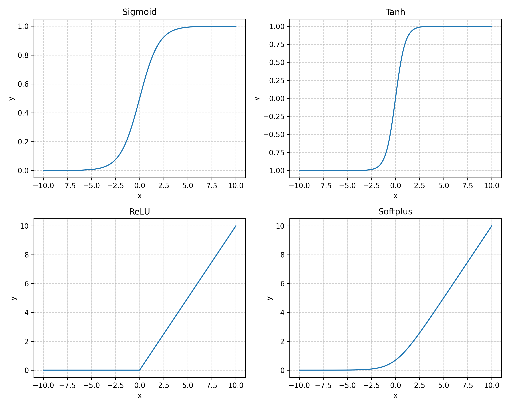
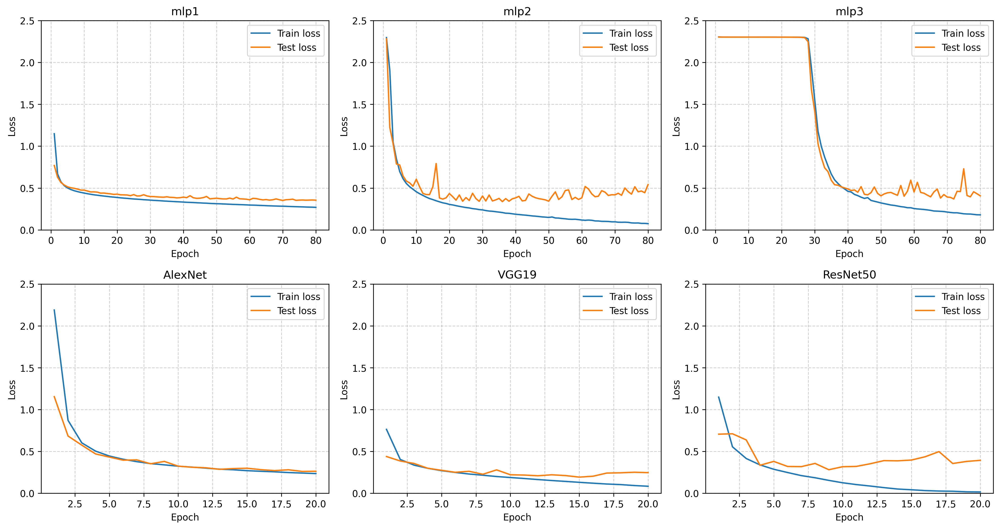
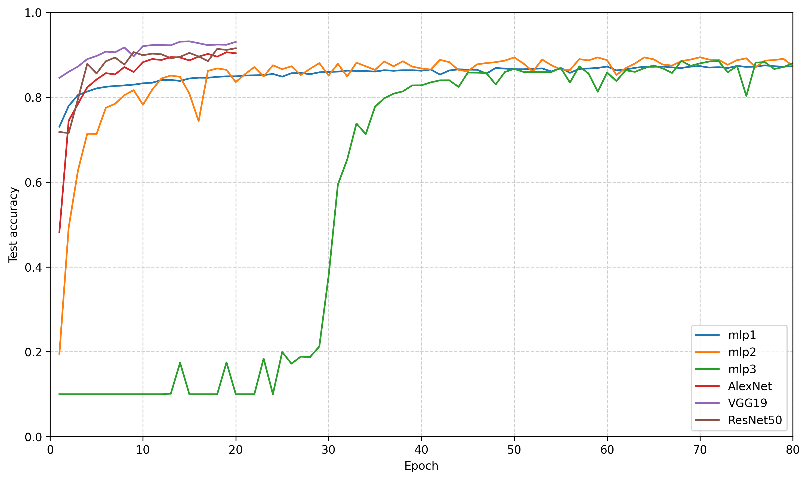
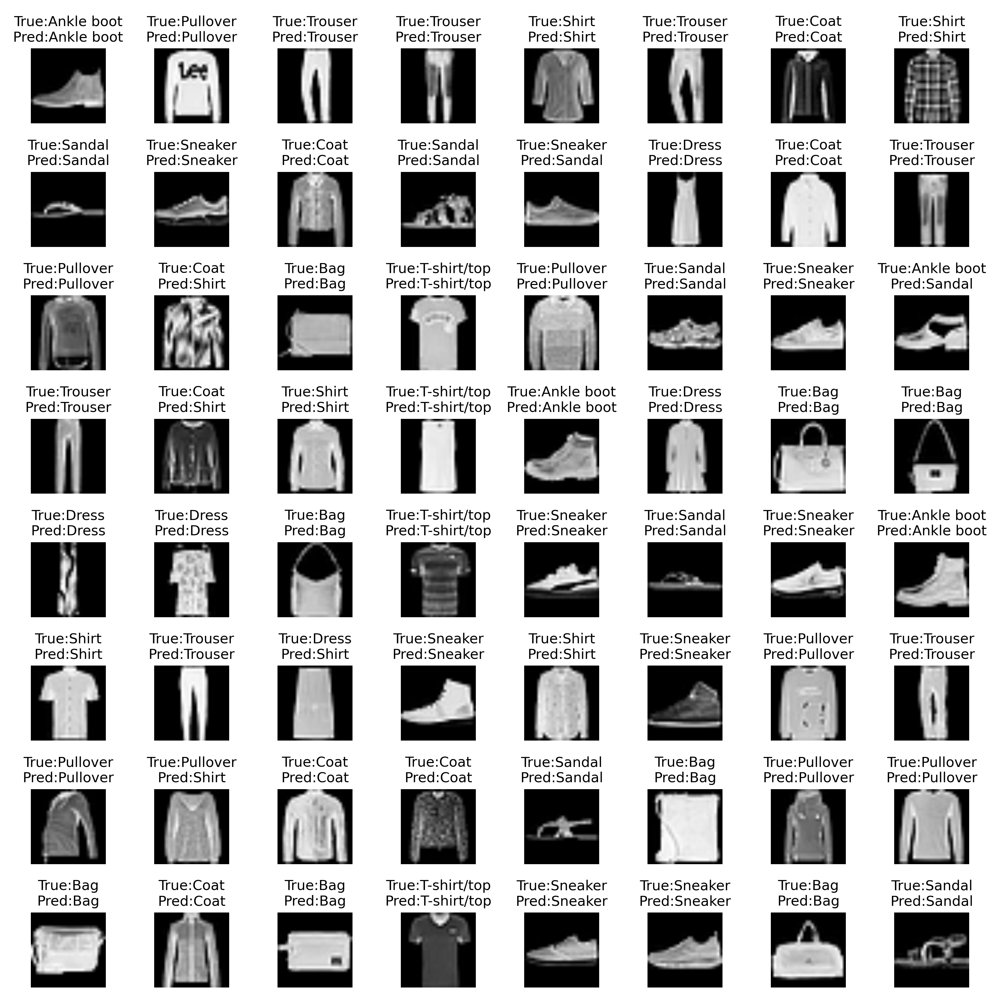

# 深度学习作业

```
#目录结构
homework1/：                        #作业1
homework2/：                        #作业2
├─ mlp1/                           #网络mlp1保存的数据
│  ├─ mlp1_plt/
│  │  ├─ mlp1_log.csv               #保存的loss、acc等
│  │  ├─ mlp1_curve.png             #不同epoch对应的loss和acc的曲线
|  |  └─ mlp1_pred_sample.png       #预测结果图
│  └─ mlp1_weights/                 #mlp1的权重
│     ├─ mlp1_best.pth
|     └─ ...
├─ mlp2/                            #网络mlp2保存的数据
│  └─ ...
├─ result                           #保存的结果图
│  ├─loss_curves.png                #每个网络Train和Test的loss
│  └─test_accuracy.png              #每个网络的Test_Acc
├─ network.py          #网络定义
├─ trainer.py          #训练模块
├─ plt.py              #单个网络的loss/acc曲线
├─ plot_curves.py      #把6个网络的结果汇总成一张图（生成result/）
└─ inference.py        #推理模块
```

> **注意：** 仓库中不包含训练好的权重文件（`*_weights/*.pth`，共约4.5G，且单个文件超过GitHub的100MB限制）。
> 如需复现推理结果，请先运行 `trainer.py` 重新训练，再进行推理。

## 作业1

> ### **1、利用pytorch中的激活函数，画出Sigmoid, Tanh, ReLU和Softplus这四种激活函数的曲线，效果类似下面的图（使用matplotlib.subplot()函数，在一个页面上画多个子图）：**

代码文件：[homework1.py](homework1/homework1.py)

生成结果：



## 作业2

> ### **2、基于Fashion-MNIT数据，利用FNN网络，实现分类。要求：**
> 
> #### 1）自己设计网络结构。项目最好包含三个文件：network.py, trainer.py和inference.py，分别用于网络结构定义，训练和推理。

网络定义：[网络定义](homework2/network.py)，定义不同网络进行训练

```
├─ 1、mlp1：浅层网络 学习率=0.01 优化器SGD
├─ 2、mlp2：较深层网络 学习率=0.01 优化器SGD
├─ 3、mlp3：增加网络深度，同时加入dropout 学习率=0.01 优化器SGD
├─ 4、AlexNet：使用卷积神经网络AlexNet处理图像 学习率=0.01 优化器SGD
├─ 5、VGG19：更深的卷积网络 学习率=0.01 优化器SGD
└─ 6、resnet50：引入残差块，可以构建更深的网络 学习率=0.01 优化器SGD
```

训练代码：[训练代码](homework2/trainer.py)

### 训练结果
> 其中mlp1、mlp2、mlp3分别跑了80个epoch
> CNN的三个网络各跑了20epoch(训练时间太长)

#### 各个模型的loss：



#### 各个模型的acc：



### 预测结果

> VGG19网络训练结果最优，故用其权重进行推理

推理代码：[推理代码](homework2/inference.py)

推理结果：
